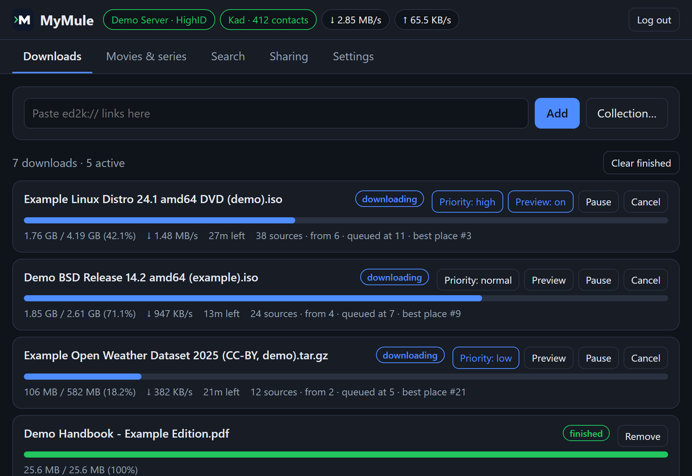

<picture>
  <source media="(prefers-color-scheme: dark)" srcset="docs/logo-dark.svg">
  
</picture>

# MyMule

**A modern eMule client for your server or NAS.** One small program for
the eD2K and Kad networks, managed from your browser, your phone or the
terminal.



<sub>The web interface with demo data: the files are made up.</sub>

## Why MyMule

- **One file, nothing else.** A single Go binary with no dependencies:
  no separate daemon, web server, Python, Node or bridge to set up. It runs
  on Windows, Linux, macOS, FreeBSD, ARM boards and NAS devices, in about
  15 MB of RAM.
- **A real eMule client.** eD2K and Kad, credits, AICH, source exchange,
  obfuscation and HighID: it talks to eMule and aMule as one of them.
- **Made to run unattended.** It runs as a service, resumes after a stop
  or a reboot, checks everything other peers send, and has secure
  defaults.
- **Everything from the browser.** A built-in web interface that works on
  phones and installs as an app, plus a command line for the terminal.

## What it does

**Downloads and sharing on eD2K and Kad.** Searches on servers and Kad,
downloads verified part by part (only the damaged blocks are downloaded
again), sharing with an upload queue and eMule's credits, priorities,
"first and last parts first" to watch a video sooner, eMule collections,
speed limits and a speed schedule, an IP filter, and ports opened on the
router by itself (UPnP / NAT-PMP).

**A web interface for any device.** Downloads, search, sharing, servers
and every setting, from any browser, phone included; it can be installed
as an app. See the [web interface guide](docs/WEBUI.md).

**Your library, organized.** Look a movie or series up by its title and
get its files scored by language and quality; finished files are renamed
into your movie and series folders, ready for Plex, Jellyfin or Kodi.
Ratings and comments from other eMule users warn about fakes, a wish list
waits for a title to come out, and categories send other downloads to
their own folders. See the [movies and series guide](docs/MEDIA.md).

**Always in view.** Speed and traffic statistics, notifications (ntfy,
Telegram, Discord or a webhook) when something finishes or fails, and
`mymule doctor`, which finds what keeps MyMule from working well and says
how to fix it.

> Only use MyMule for content you are allowed to download and share. See
> the [terms of use and disclaimer](#terms-of-use-and-disclaimer).

## Install

| System | How |
|---|---|
| Any, with Docker (also NAS, Raspberry Pi) | see [Docker](#docker) below |
| macOS, Linux | `brew install i234dev/tap/mymule` ([Homebrew](https://brew.sh)) |
| Windows | `scoop bucket add mymule https://github.com/i234dev/scoop-bucket` then `scoop install mymule` ([Scoop](https://scoop.sh)) |
| Any | download the archive for your system from [Releases](../../releases) and unpack it |

Then turn the web interface on in `mymule.conf` (created next to the
program on the first run), start MyMule and open <http://127.0.0.1:4711/>,
logging in with the `api_key` from the same file:

```ini
web_ui = true
```

```sh
mymule start
```

### Docker

Save [docker-compose.yml](docker-compose.yml) in an empty folder and run
there:

```sh
docker compose up -d
```

Then open <http://localhost:4711> and log in with the `api_key` from
`config/mymule.conf`. The [install guide](docs/INSTALL.md) covers Docker in
detail, running MyMule as a service on a server or NAS, and checking a
download.

## Works with

- **Radarr, Sonarr, Lidarr, Readarr and Prowlarr**: MyMule is a Torznab
  indexer and a qBittorrent-compatible download client for them, so eD2K
  becomes one more source. See [docs/ARR.md](docs/ARR.md).
- **Plex, Jellyfin and Emby**: asked to scan their libraries when files
  arrive. See [the movies and series guide](docs/MEDIA.md#notifications-and-your-media-server).
- **Your scripts**: an HTTP API for PHP, Python, cron jobs or home
  automation. See [docs/API.md](docs/API.md).

## For the terminal

MyMule runs as a background daemon controlled with short commands, and
`mymule top` shows everything live, full screen, where you can also search
and manage downloads:

```sh
mymule status                # server, speed and progress of every download
mymule add "ed2k://|file|...|/"
mymule top                   # live view (q to quit)
mymule doctor                # what keeps MyMule from working well
```


Every command is in the [command line guide](docs/CLI.md), and every
setting in [Configuration, network and security](docs/CONFIG.md).

## MyMule and aMule

MyMule started as a personal project, to have the eMule network in my home
server the way I wanted. When I began, I didn't know aMule was being
revived. Today there are great options, and you should pick the one that
fits you:

- **[aMule](https://github.com/amule-org/amule)** is the mature,
  long-standing eMule-compatible client, actively developed again. It has a
  desktop GUI, a headless daemon, a web UI and a REST API, and more of
  eMule's classic features (friends, chat...). Together
  with **[aMuTorrent](https://github.com/got3nks/amutorrent)** you also get a
  modern web interface that manages aMule and your torrent clients
  together, with Sonarr/Radarr support.
- **MyMule** is a smaller, independent client written from scratch in Go.
  It may suit you if you want:
  - a single program, with no separate daemon, web interface or bridge to
    set up and connect;
  - a media-library workflow: search a movie or series by title, get its
    files scored by language and quality, and find the result renamed in
    your library;
  - a small footprint (about 15 MB of RAM) and secure defaults.

If you need a feature MyMule doesn't have, or the most battle-tested
client, aMule is a great choice. Both talk to the same network and to each
other, so either way you're helping keep eD2K and Kad alive.

## Documentation

| Guide | What it covers |
|---|---|
| [Install](docs/INSTALL.md) | Every system, Docker, running as a service on a server or NAS, checking a download, building |
| [Web interface](docs/WEBUI.md) | The tabs, phones and the app, using it from other devices |
| [Movies and series](docs/MEDIA.md) | Finding titles, how files are chosen, fakes, your library, the wish list |
| [Command line](docs/CLI.md) | Every command and `mymule top` |
| [Configuration, network and security](docs/CONFIG.md) | `mymule.conf`, HighID, Kad, how MyMule works with the eMule network, security |
| [Radarr, Sonarr...](docs/ARR.md) | Using MyMule as an indexer and download client for the *arr apps |
| [HTTP API](docs/API.md) | Every endpoint, with examples in curl, PHP and Python |

## Security

MyMule talks to strangers, so everything servers and peers send is checked
and bounded, and its defaults are safe: the API and web interface only
answer on this computer until you change `api_listen`, the web interface
is off until you turn it on, and the `api_key` is long and random. What is
up to you, and how MyMule protects itself, is in
[Security](docs/CONFIG.md#security). Remember that eD2K is public: other
users see your IP address and the files you share.

Every release has a `SHA256SUMS` file and a signed build provenance
attestation; see [Checking a download](docs/INSTALL.md#checking-a-download).

To report a security problem, please open a GitHub issue asking for a
private contact rather than describing it publicly.

## Building

Requires Go (see `go.mod` for the version):

```sh
go test ./...
go build -o mymule ./cmd/mymule
```

More, including cross-compiling and CI, in
[Building from source](docs/INSTALL.md#building-from-source). Ideas and
bug reports are welcome in [Issues](../../issues).

## Terms of use and disclaimer

By downloading, installing or using MyMule you accept these terms. If you
don't accept them, don't use MyMule.

1. **What MyMule is.** MyMule is free, open-source software that connects
   to the public eD2K network. It is a tool: it doesn't host, index,
   provide, control or endorse any content found on that network.
2. **Lawful use only.** You may only use MyMule to search, download,
   share or distribute content that is in the public domain, that is
   released under a license that allows it (for example free software or
   Creative Commons works), that you own, that you have permission from
   the rights holder to use, or whose download and sharing is allowed by
   the laws of your country. Downloading or sharing copyrighted material
   without permission may be illegal where you live.
3. **You are responsible.** You alone are responsible for what you search,
   download and share with MyMule, and for complying with the laws that
   apply to you (copyright, intellectual property, privacy and others).
   Note that eD2K is a public network: other users can see your IP address
   and the files you share, and by default MyMule shares your completed
   downloads and the verified parts of the files you are downloading.
4. **No warranty.** MyMule is provided "as is", without warranty of any
   kind, as stated in the GNU General Public License (sections 15 and 16).
5. **No liability.** The authors and contributors of MyMule are not
   responsible for how it is used, for the content other users share on
   the network, or for any damage, loss or legal consequence resulting from
   its use.
6. **Third parties.** File names and search results come from other users
   of the network. Servers, TMDB, Wikidata and any other services MyMule
   talks to have their own terms; MyMule is not affiliated with or endorsed
   by any of them, nor by any rights holder.

This text is not legal advice. If you are unsure whether something is
allowed where you live, don't download or share it.

## License

Copyright (C) 2026 i234dev

This program is free software: you can redistribute it and/or modify it
under the terms of the GNU General Public License as published by the Free
Software Foundation, either version 3 of the License, or (at your option)
any later version. See [LICENSE](LICENSE).
