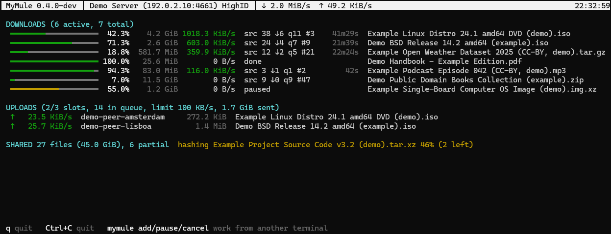
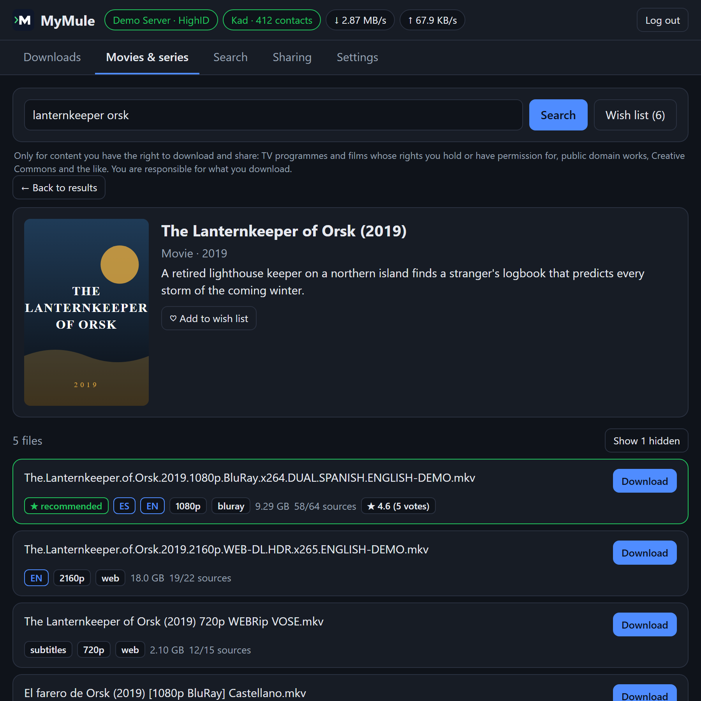

<picture>
  <source media="(prefers-color-scheme: dark)" srcset="docs/logo-dark.svg">
  
</picture>

# MyMule

A client for the eMule networks, eD2K (servers) and Kad (serverless),
written in Go. One small binary with no dependencies that runs anywhere
(Windows, Linux, macOS, FreeBSD, ARM boards and NAS devices) and uses
about 15 MB of RAM.

Use it the way that suits you:

- **Web interface**: search movies and series by title (with posters, in
  your language), get the files of that work scored by language and
  quality, download them and have them renamed into your movie and series
  library. Downloads, searches, sharing and servers, from any browser,
  phone included. See [Web interface](#web-interface).
- **Command line**: a background daemon with short commands (`status`,
  `add`, `pause`...) and `mymule top`, a live full-screen view where you
  can also search and manage downloads. See [Quick start](#quick-start).
- **Radarr, Sonarr, Lidarr, Readarr and Prowlarr**: MyMule works as a
  Torznab indexer and a qBittorrent-compatible download client, so eD2K
  becomes one more source for them. See
  [Radarr, Sonarr...](#radarr-sonarr-lidarr-readarr-and-prowlarr).

There is also an [HTTP API](#http-api-for-scripts) for scripts (PHP,
Python, cron, home automation).

> **Please read the [terms of use and disclaimer](#terms-of-use-and-disclaimer)
> before using MyMule.** In short: only use it for content you are allowed
> to download and share.



<sub>`mymule top` with demo data (`mymule top -demo`).</sub>

## Features

- Search on the connected server, or on every known server at once
  (`search -global`, over UDP); a server that stops answering doesn't
  leave the search empty
- Downloads from eD2K peers, with MD4 verification of every 9.28 MB part:
  corrupt parts are downloaded again, and a peer that keeps sending bad
  data is not used for that file any more. With AICH (an `h=` in the
  link, or a hash enough peers agree on), only the bad 180 KB blocks of
  a corrupt part are downloaded again; MyMule gives other clients the
  AICH data of its shared files too
- Sources from every server in the list (UDP), not only the connected one
- Opens its ports on the router by itself (UPnP or NAT-PMP) when the
  router allows it
- IP filter: eMule's `ipfilter.dat` (or a list downloaded every week from
  `ip_filter_url`) blocks connections from and to the addresses in it
- Wish list: MyMule searches by itself for the movies and episodes you
  want and downloads them when a good file shows up, starting the day they
  come out at home (digital or disc) or air, not while they are only in
  cinemas
- Ratings and comments that eMule users leave on files (from Kad) shown
  next to the files found for a movie or series, so fakes stand out; the
  wish list never downloads a file people call fake
- Download and upload speed limits; queue places asked over UDP, as eMule
  does, instead of a new connection each time
- Source exchange with other eMule clients: the peers you download from
  tell you where else the file is, and you tell them (only sources that
  answered, with a public address, a limited number and not too often)
- Kad, eMule's network without servers: searches and sources there too,
  your shared files published, and a full Kad node for others (see
  [Kad](#kad))
- Sharing and uploads: shared folders, completed downloads and the verified
  parts of partial downloads; upload queue, slots taken in turns (10 MB
  or 15 minutes each), speed limit
- eMule's credit system: peers that uploaded to you move up in your upload
  queue, and MyMule proves who it is (secure identification) so that the
  eMule and aMule users you upload to do the same for you. Credits only go
  to peers that prove their identity; they are kept in `credits.dat`, and
  your key in `cryptkey.dat` (keep it: with a new one, peers no longer
  recognize you)
- Protocol obfuscation, as eMule's: connections to other users and to
  servers look like random data, which hides eMule traffic from internet
  providers that slow it down (`obfuscation` in `mymule.conf`). It does not
  make you anonymous
- Resume after a stop, a crash or a reboot
- HighID support (listen port) and server callbacks to reach firewalled peers
- Runs as a background daemon, controlled with short commands
  (`status`, `add`, `pause`, `cancel`...) over a local, token-protected API
- `mymule top`: live full-screen view; search, pick what to download and
  pause, resume or cancel downloads without leaving it
- Server list with users and files; switch server or choose one to always
  use (web interface)
- Optional web interface (downloads, search, sharing) that works on phones
  too; off by default
- HTTP API for scripts, and optional Radarr/Sonarr/Lidarr/Readarr/Prowlarr
  support (Torznab indexer + qBittorrent-compatible client)
- Light: about 15 MB of RAM
- Portable: settings and data live next to the executable
- Built to face hostile peers and servers: everything they send is
  checked and bounded (see [Security](#security))

## MyMule and aMule

MyMule started as a personal project, to have the eMule network in my home
server the way I wanted. When I began, I didn't know aMule was being
revived. Today there are great options, and you should pick the one that
fits you:

- **[aMule](https://github.com/amule-org/amule)** is the mature,
  long-standing eMule-compatible client, actively developed again. It has a
  desktop GUI, a headless daemon, a web UI and a REST API, and more of
  eMule's classic features (priorities, categories, preview...). Together
  with **[aMuTorrent](https://github.com/got3nks/amutorrent)** you also get a
  modern web interface that manages aMule and your torrent clients
  together, with Sonarr/Radarr support.
- **MyMule** is a smaller, independent client written from scratch in Go.
  It may suit you if you want:
  - a single program, with no separate daemon, web interface or bridge to
    set up and connect;
  - a media-library workflow: search a movie or series by title, get its
    files scored by language and quality, and find the result renamed in
    your library;
  - a small footprint (about 15 MB of RAM) and secure defaults.

If you need a feature MyMule doesn't have, or the most battle-tested
client, aMule is a great choice. Both talk to the same network and to each
other, so either way you're helping keep eD2K and Kad alive.

## Install

| System | How |
|---|---|
| Any, with Docker (also NAS, Raspberry Pi) | see [Docker](#docker) |
| macOS, Linux | `brew install i234dev/tap/mymule` ([Homebrew](https://brew.sh)) |
| Windows | `scoop bucket add mymule https://github.com/i234dev/scoop-bucket` then `scoop install mymule` ([Scoop](https://scoop.sh)) |
| Any | download the archive for your system from [Releases](../../releases) and unpack it |

Installed with Homebrew, MyMule keeps its settings and downloads in
`~/MyMule`; with Scoop, in `%USERPROFILE%\scoop\persist\mymule`. Both keep
them across upgrades (`brew upgrade mymule`, `scoop update mymule`).

## Quick start

Then run:

```sh
mymule servers update        # fetch a server list
mymule start                 # start the engine in the background
mymule search -links ubuntu  # search; -links prints ed2k:// links
mymule add "ed2k://|file|...|/"
mymule top                   # live view (q to quit)
mymule stop
```

Quote ed2k links: they contain `|`, which shells treat as a pipe.

Run `mymule help` for every command and `mymule <command> -h` for its flags.

The daemon also fetches a server list by itself when it knows none, so
`servers update` is only needed to refresh it.

## Docker

An image for Linux (amd64, arm64 and armv7, so also Raspberry Pi and most
NAS devices) is published with every release. With Docker installed
([Docker Desktop](https://www.docker.com/products/docker-desktop/) on
Windows and macOS), save [docker-compose.yml](docker-compose.yml) in an
empty folder and run there:

```sh
docker compose up -d
```

Then open <http://localhost:4711> and log in with the `api_key` from
`config/mymule.conf` (created in that folder on the first start). Finished
files go to `downloads/`, partial ones to `downloads/incomplete/`.

Without Compose, the same in one command:

```sh
docker run -d --name mymule --restart unless-stopped   -e PUID=1000 -e PGID=1000 -e TZ=Etc/UTC   -v ./config:/config -v ./downloads:/downloads   -p 4662:4662/tcp -p 4672:4672/udp -p 127.0.0.1:4711:4711/tcp   ghcr.io/i234dev/mymule:latest
```

- **Which user**: MyMule never runs as root. `PUID` and `PGID` are the user
  and group that own the files (on Linux, run `id` to see yours; on
  Windows and macOS the defaults are fine).
- **Settings**: edit `config/mymule.conf`, or set any setting as an
  environment variable `MYMULE_<SETTING>`, e.g. `MYMULE_ARR_SUPPORT=true`
  or `MYMULE_SEARCH_LANGUAGES=es`. Variables win over the file. The image
  turns on the web interface and listens on the container's network
  (`MYMULE_WEB_UI=true`, `MYMULE_API_LISTEN=0.0.0.0:4711`).
- **Commands**: `docker exec mymule mymule status`, `docker logs mymule`
  for the log. Commands run as the `PUID` user even from `docker exec`.
- **HighID**: forward ports 4662 (TCP) and 4672 (UDP) in your router to
  the computer running Docker.
- **Web interface from other devices**: port 4711 (the web interface and
  the API) is published on `127.0.0.1` only. To open it from your phone
  or another computer, publish it on this computer's LAN address instead
  (`<LAN-IP>:4711:4711/tcp`). Never publish it on every address
  (`4711:4711`) of a computer that is on the Internet, such as a VPS:
  Docker's published ports bypass ufw and firewalld, so the API would be
  open to anyone, with only the `api_key` in the way. **Never forward
  port 4711** in your router either.
- **Update**: `docker compose pull && docker compose up -d`. Each release
  is also tagged by version (`:X.Y.Z` and `:X.Y`) if you prefer to
  choose when to update.
- **Radarr, Sonarr...**: set `MYMULE_ARR_SUPPORT=true`; MyMule reports
  downloads as `/downloads/...`, so mount the same folder in the apps as
  `/downloads` too (or add a Remote Path Mapping). See
  [docs/ARR.md](docs/ARR.md).

## Configuration

On first run MyMule creates `mymule.conf` next to the executable:

```ini
port = 4662            # TCP port for peers; forward it in your router for HighID
kad = true             # Kad network (no servers needed): true or false
kad_port = 4672        # UDP port for Kad; forward it in your router (UDP) too
upnp = true            # open port and kad_port on the router (UPnP / NAT-PMP); false = by hand
kad_nodes_url = https://upd.emule-security.org/nodes.dat  # first Kad nodes; empty = only from other clients
server =               # ip:port, or empty to choose automatically
nick = MyMule
temp_dir = temp        # partial downloads (relative or absolute path)
download_dir = downloads
max_conns = 40
obfuscation = true     # hide eMule traffic: true, required (only obfuscated) or false
sharing = true         # master switch: false = share and upload nothing
share_downloads = true # share download_dir (partial downloads: verified parts only)
shared_dirs =          # more folders to share, separated by ';'
upload_slots = 20      # peers served at the same time; the rest queue
upload_limit = 1000    # KB/s, 0 = no limit
download_limit = 0     # KB/s, 0 = no limit (else at least 32)
ip_filter_url =        # IP filter list (ipfilter.dat / P2P, plain, gz or zip) refreshed weekly; empty = only your own ipfilter.dat
api_listen = 127.0.0.1:4711  # HTTP API for scripts/apps; empty = off
api_key = (random)      # generated on first run, required by the API
api_hosts =            # extra names the API/web answer to (NAS name, proxy domain)
network_hosts =        # Windows: computers whose \\host\share folders may be library folders
web_ui = false         # true: web interface at http://127.0.0.1:4711/
tmdb_api_key =         # empty: MyMule's TMDB key; your own key; or off
arr_support = false    # true: Radarr/Sonarr/Prowlarr support (see below)
search_languages =     # e.g. es: Radarr/Sonarr also search by Spanish titles
```

Settings added in newer versions are appended to an existing file, with
their comments, so you can see them.

Shared files are hashed in the background the first time (this reads the
whole file); the result is cached in `known.json`, so restarts are instant.

Command-line flags (`-port`, `-server`, `-o`...) override the file for one run.
So do environment variables named `MYMULE_` plus the setting in capitals
(`MYMULE_WEB_UI=true`, `MYMULE_UPLOAD_LIMIT=500`), which is how the
[Docker](#docker) image is configured; they are not written into the file.
Set `MYMULE_HOME` to keep data somewhere other than the executable's folder,
for example when the binary is installed in a read-only location.

### HighID

Peers that cannot reach you only serve you if they can reach you instead,
so forwarding the TCP port (`port` in the config) to your machine gets you
far more sources. `mymule status` shows whether you have HighID or LowID.
If your router allows UPnP or NAT-PMP, MyMule opens the TCP port and the
Kad UDP port on it by itself (and closes them when it stops); the log
says whether it could. Otherwise forward them by hand, or set
`upnp = false` to never try. In Docker this only works with host
networking.
If you have a listen port configured but get LowID, MyMule tries other
servers, since some servers never test the port.

### Kad

Kad is eMule's serverless network. With `kad = true` (the default),
MyMule joins it as a full node, as eMule does:

- global searches (web interface, API, *arr apps) ask Kad too, and every
  download looks for sources there once an hour, so files only found on
  Kad (marked `[kad ...]` by some servers) download as well;
- your shared files are published on Kad, so Kad users find them;
- MyMule keeps what other users publish near its Kad ID and answers
  their searches.

The first time, MyMule gets a list of Kad nodes from `kad_nodes_url`
(the address eMule offers, over HTTPS); later it remembers them in
`nodes.dat`. With `kad_nodes_url` empty it starts from the eMule clients
it meets instead. Nodes from a downloaded list are only used, or passed
on to others, once they answer MyMule with its key.

Forward the Kad UDP port (`kad_port`, 4672 by default) in your router,
as well as the TCP port. Without them Kad still works, behind a firewall:
other nodes reach you through a "buddy" node, or by asking you to connect
to them, and MyMule stores nothing for others (it could not be searched).
`mymule status`, `mymule top` and the web interface show Kad's state.

## Web interface

An optional web interface, built into the program (no extra files). It is
**off by default**; turn it on in `mymule.conf` and restart the daemon:

```ini
web_ui = true
```

Then open `http://127.0.0.1:4711/` (the `api_listen` address) and log in
with the `api_key` from `mymule.conf`.



<sub>The Movies & series tab with demo data: the titles and files are made up.</sub>

It has five tabs:

- **Downloads**: progress, speed, sources and queue position; pause,
  resume, cancel, clear finished, and add `ed2k://` links.
- **Movies & series**: search a movie or series by title, in your
  browser's language, and pick it from a list with posters (title, year,
  original title, synopsis). MyMule then searches eD2K by all its titles
  (yours, the original and alternative ones), keeps only the files of
  that work (not remakes, episodes of other shows or other movies with
  similar names) and shows them with their language, resolution, source,
  size and sources, the recommended one first. Files with no sources,
  only found on Kad/torrent, or cam copies are hidden but can be shown.
  For series, pick a season and an episode from the lists (with episode
  titles), or the whole season.
- **Search**: search every known server, with type, size and extension
  filters; sort and filter the results and download one or several.
- **Sharing**: shared files, upload speed and who is downloading from you.
- **Settings**: how files for movies and series are chosen (audio
  languages in order of preference, original version with subtitles,
  preferred resolution, maximum size, hide cam copies), the movie and
  series library (see below), and **Advanced settings**: everything in
  `mymule.conf` (ports, Kad, UPnP, folders, sharing, speed limits, the IP
  filter list...), written into the file and applied when MyMule
  restarts. Who can reach MyMule (`api_listen`, `api_key`, `api_hosts`,
  `network_hosts`, `web_ui`) is shown but only changed in the file. It
  also says which ports UPnP / NAT-PMP opened on the router, as does a
  chip at the top and `mymule status`.

Click the server name at the top to see the server list, sorted by users
or files: connect to another server, choose one to always use (the others
are tried only if it doesn't answer) or download a fresh list. Global
searches and sources use all servers anyway.

It works on phones, follows the system's light or dark theme and is shown
in English or Spanish depending on the browser's language.

To use it from another device (a phone, another computer), set
`api_listen = 0.0.0.0:4711` and open `http://<computer-ip>:4711/`. Only do
this on a network you trust, and never forward port 4711 in your router.
If you open it by a name instead of an address (a NAS name, a domain
behind a reverse proxy), add that name to `api_hosts`.

The session lasts 30 days. **Log out** ends it for good, also for any copy
of the session cookie; changing `api_key` logs everybody out. After 10
wrong keys from one address, that address is blocked for 15 minutes; a
long random key like the generated one keeps working even then, so
nobody can lock you out, and wrong keys that other web sites make your
browser send don't count.

When `web_ui = false` the pages don't exist and nothing extra runs; the
interface only uses resources while a browser has it open.

### Movie and series data

Movie and series data and posters come from
[TMDB](https://www.themoviedb.org), with
[Wikidata](https://www.wikidata.org) as a fallback. MyMule includes its
own TMDB key, so there is nothing to set up; you can use your own key
(`tmdb_api_key`) or `tmdb_api_key = off` to use only Wikidata, without
posters. Only search words and ids are sent; posters are fetched by
MyMule (your browser never contacts TMDB) and kept in a small cache
(`cache/posters`, at most 100 MB).

This product uses the TMDB API but is not endorsed or certified by TMDB.

### Movie and series library

Files downloaded from the **Movies & series** tab can be renamed and moved
into their own folders when they finish, ready for Plex, Jellyfin or Kodi.
It is off until you turn on **Organize movies and series** in **Settings**;
when you download a file, the web interface tells you where it will go.
Then choose:

- **Movies folder** and **Series folder** on the computer where MyMule
  runs. Leave one empty to rename those files inside `download_dir`
  instead (only the last part of the template is used there, so they
  stay in that folder and keep being shared). MyMule must be able to
  write in the folders: on Linux, give them to the user it runs as.
- **File names** from ready-made templates or your own, with a live
  example. Templates use tags: `{title}`, `{original_title}`, `{year}`,
  `{quality}`, `{language}`, `{season}`, `{episode}`, `{episode_title}`;
  `/` makes a folder and `{season:2}` adds a leading zero. For example
  `{title} ({year})/{title} ({year})` gives
  `Example Movie (1999)/Example Movie (1999).mkv`, and
  `{title}/Season {season:2}/{title} - S{season:2}E{episode:2}` gives
  `Example Show/Season 01/Example Show - S01E02.mkv`.
- Whether file names use the **title in your language or the original**.
- Whether to **share** those folders (with their subfolders). Moved files
  keep being shared without hashing them again.

Only video, audio and subtitle files are organised. Names are made safe
for Windows, macOS and Linux, files are never overwritten (a ` (2)` is
added) and nothing is ever written outside the chosen folders. Settings
are kept in `preferences.json`.

## HTTP API for scripts

The daemon serves a JSON API (search, add, pause, resume, cancel, status)
for PHP, Python, shell scripts, cron jobs or home automation. It listens
on `127.0.0.1:4711` by default and every request needs the `api_key` from
`mymule.conf`:

```sh
curl -H "X-Api-Key: YOUR_API_KEY" "http://127.0.0.1:4711/api/v1/search?q=example+distro"
```

See [docs/API.md](docs/API.md) for every endpoint and examples in curl,
PHP and Python.

## Radarr, Sonarr, Lidarr, Readarr and Prowlarr

If you already run the *arr apps, MyMule adds the eD2K network as one more
source. It is most useful for what is hard to find on torrents: dubbed
versions, older films and series, rare releases. The apps don't need any
plugin: MyMule speaks the protocols they already know.

It is **off by default**: set `arr_support = true` in `mymule.conf` to turn
it on. With it off, none of these endpoints exist.

### What is supported

| Feature | Details |
|---|---|
| **Torznab indexer** (`/torznab/api`) | Movie, TV (season/episode), music, audio, book and general searches over all known eD2K servers; Newznab categories (Movies, TV, Audio, Books, PC, Other). Works in Prowlarr ("Generic Torznab") or directly in each app ("Torznab", custom). |
| **qBittorrent-compatible download client** (`/api/v2`) | Login, add (stand-in `.torrent` or plain `ed2k://` links), categories, pause/resume, remove (with or without files), progress and save path until the app imports the file. |
| **Search in your language** | With `search_languages` (e.g. `es`, `it`, `fr`), searches also use the title in those languages, looked up on Wikidata from the IMDb/TMDB/TVDB id. Off by default. |
| **Cleaner results** | Results nobody shares are left out; server prefixes such as `[kad example.org]` are removed; short language tags (`Spa`, `ESP-ING`, `[ita, eng]`...) get the full name added so the apps detect the language. Files keep their real name. |
| **Safe by default** | Same address and `api_key` as the HTTP API, only on this computer unless you change `api_listen`. Download links in the results are signed for their own file and don't contain the `api_key`. Changes (add, remove, pause) need POST. Removing with files only deletes inside `download_dir`. |

### Quick setup

1. In `mymule.conf`, set `arr_support = true`. Keep
   `api_listen = 127.0.0.1:4711` if the apps run on
   the same computer, or use `0.0.0.0:4711` if they run in Docker or on
   another machine of your network. Copy `api_key`. Optionally set
   `search_languages`. Restart the daemon.
2. **Indexer**: in Prowlarr add *Generic Torznab* (or in Radarr/Sonarr,
   *Settings* → *Indexers* → *Torznab* → *Custom*) with URL
   `http://<mymule-host>:4711/torznab`, API path `/api` and your `api_key`.
3. **Download client**: in each app, *Settings* → *Download Clients* →
   *qBittorrent*, host `<mymule-host>`, port `4711`, any username, your
   `api_key` as password, and a category (`radarr`, `tv-sonarr`...).
4. **Paths**: the app must see MyMule's `download_dir`. On the same
   computer there is nothing to do; otherwise mount that folder in the app
   and, if the path differs, add a *Remote Path Mapping*.

### Limitations

- Results whose only sources are on the Kad network (marked
  `[kad ...]` by some servers) need Kad (`kad = true`, the default) to
  download.
- eD2K downloads can take a while to start, because peers serve uploads in
  queues. HighID (see above) helps a lot.
- One file per download: eD2K links are single files.
- Never forward port 4711 in your router: the API is meant for your own
  network.

Step-by-step guide, including Docker and Remote Path Mappings:
[docs/ARR.md](docs/ARR.md).

## Running on a server or NAS

`mymule daemon` runs the engine in the foreground, which suits systemd,
OpenRC, Docker or a NAS task scheduler. Run it as its own user, never as
root, and start and stop it through the service manager (not with
`mymule start` as root, which would leave a second copy running as root).

Example systemd unit, with the program and its data in `/opt/mymule`
(owned by the `mymule` user) and downloads in `/data`:

```ini
[Unit]
Description=MyMule eD2K client
After=network-online.target
Wants=network-online.target

[Service]
ExecStart=/opt/mymule/mymule daemon
User=mymule
Group=mymule
Restart=on-failure
# Private files by default, and no way to gain privileges.
UMask=0077
NoNewPrivileges=yes
# Read-only system, private /tmp, no access to other users' homes;
# only the data and download folders are writable.
ProtectSystem=strict
ProtectHome=yes
PrivateTmp=yes
ReadWritePaths=/opt/mymule /data
ProtectKernelTunables=yes
ProtectKernelModules=yes
ProtectControlGroups=yes
RestrictSUIDSGID=yes
LockPersonality=yes

[Install]
WantedBy=multi-user.target
```

If a media server (Plex, Jellyfin) has to read the finished files, use
`UMask=0022` instead, or give it a group with access to `/data`.

**Logs.** Under a service manager the log belongs to it (journald, or the
file set in OpenRC's `output_log`); rotate that file with `logrotate`, for
example `/etc/logrotate.d/mymule`:

```
/opt/mymule/mymule.log {
    weekly
    rotate 4
    compress
    missingok
    copytruncate
}
```

`mymule start` manages its own log instead and keeps one previous copy
(`mymule.log.1`) when it passes 20 MB. Either way, chat messages from other
users are logged at most 20 per minute, so nobody can fill the disk with
them.

## Security

MyMule talks to strangers: servers and peers can send anything. Everything
they send is checked and bounded: packet and message sizes, tag counts,
decompression, file sizes (256 GiB at most), the number of connections,
sources and queue places per address, and where MyMule will connect to
(only public addresses, never your own network). Data written to a part
that was already verified is refused, and every finished file is checked
against its hash once more before it is handed over. Kad packets are
checked the same way, and what other nodes can make MyMule store, send or
connect to is limited (in bytes, packets and connections, for each
address and in all). Storing what a node publishes needs proof of its
address; the few requests that make MyMule send or connect without it
(firewall checks and callbacks for other nodes, as in eMule) only reach
public addresses, a few at a time. A bug triggered by
what a peer sends ends that connection, not the program. Text from the
network (file names, nicks, messages) is cleaned before it reaches the
terminal or the log.

What is up to you:

- **Keep the API private.** Leave `api_listen` on `127.0.0.1` unless you
  need the web interface or the *arr apps from another device, and never
  forward port 4711 in your router. The `api_key` gives full control of
  MyMule: treat it like a password and keep the generated random one.
- **Keep MyMule's folder private.** Its files (`mymule.conf` with the
  `api_key`, the log, the list of shared files) are created readable only
  by you, and MyMule never shares them. On Windows, keep the MyMule folder
  inside your user profile (for example in Documents), not directly under
  `C:\`, where other users of the computer could read the key or replace
  `mymule.exe`; MyMule warns you if it is elsewhere.
- **Movie and series folders** can't be a drive root, your user folder,
  a system folder or MyMule's own folder, and only video, audio and
  subtitle files are moved into them or shared from them.
- **Remember eD2K is public**: other users see your IP address and the
  files you share. Finished downloads are shared by default, as in eMule
  (`share_downloads = false` to stop).

**Checking a download.** Every release has a `SHA256SUMS` file and a
signed build provenance attestation, which ties each file to this
repository and the exact commit it was built from. With the GitHub CLI:

```sh
gh attestation verify mymule-v1.1.2-linux-amd64.tar.gz --repo i234dev/MyMule
```

The Windows and macOS binaries are not signed with a commercial
certificate, so Windows SmartScreen or macOS Gatekeeper may warn the
first time you run them; the attestation above is how to check them.

To report a security problem, please open a GitHub issue asking for a
private contact rather than describing it publicly.

## Building

Requires Go (see `go.mod` for the version).

```sh
go test ./...
go build -o mymule ./cmd/mymule
# cross-compile, e.g. for a Raspberry Pi:
GOOS=linux GOARCH=arm GOARM=7 CGO_ENABLED=0 go build ./cmd/mymule
```

Every push builds and tests on Windows, Linux and macOS, checks the code
and its dependencies for known vulnerabilities (`govulncheck`), and
attaches the binaries to the workflow run. Pushing a tag `vX.Y.Z`
publishes a Release with archives for every platform, a `SHA256SUMS` file
and a signed build provenance attestation (see [Security](#security)).

To build with your own TMDB key instead of the project's:
`go build -ldflags "-X mymule/internal/meta.ProjectTMDBKey=YOUR_KEY" ./cmd/mymule`.

## Terms of use and disclaimer

By downloading, installing or using MyMule you accept these terms. If you
don't accept them, don't use MyMule.

1. **What MyMule is.** MyMule is free, open-source software that connects
   to the public eD2K network. It is a tool: it doesn't host, index,
   provide, control or endorse any content found on that network.
2. **Lawful use only.** You may only use MyMule to search, download,
   share or distribute content that is in the public domain, that is
   released under a license that allows it (for example free software or
   Creative Commons works), that you own, that you have permission from
   the rights holder to use, or whose download and sharing is allowed by
   the laws of your country. Downloading or sharing copyrighted material
   without permission may be illegal where you live.
3. **You are responsible.** You alone are responsible for what you search,
   download and share with MyMule, and for complying with the laws that
   apply to you (copyright, intellectual property, privacy and others).
   Note that eD2K is a public network: other users can see your IP address
   and the files you share, and by default MyMule shares your completed
   downloads and the verified parts of the files you are downloading.
4. **No warranty.** MyMule is provided "as is", without warranty of any
   kind, as stated in the GNU General Public License (sections 15 and 16).
5. **No liability.** The authors and contributors of MyMule are not
   responsible for how it is used, for the content other users share on
   the network, or for any damage, loss or legal consequence resulting from
   its use.
6. **Third parties.** File names and search results come from other users
   of the network. Servers, TMDB, Wikidata and any other services MyMule
   talks to have their own terms; MyMule is not affiliated with or endorsed
   by any of them, nor by any rights holder.

This text is not legal advice. If you are unsure whether something is
allowed where you live, don't download or share it.

## License

Copyright (C) 2026 i234dev

This program is free software: you can redistribute it and/or modify it
under the terms of the GNU General Public License as published by the Free
Software Foundation, either version 3 of the License, or (at your option)
any later version. See [LICENSE](LICENSE).
