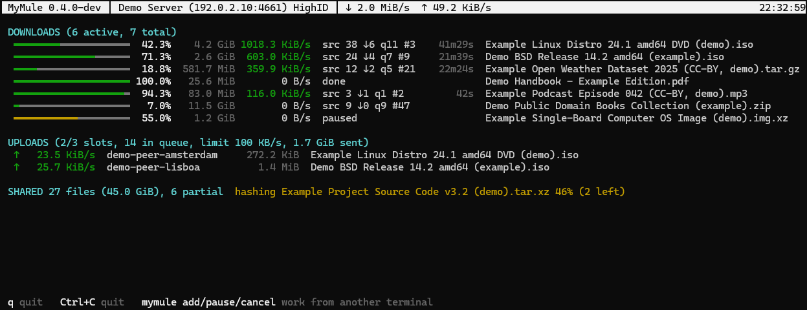

# The command line

MyMule runs as a background daemon that you control with short commands,
and `mymule top` shows everything live, full screen. The web interface
does the same from a browser; the command line is handy over SSH, in
scripts, or when you prefer a terminal.



<sub>`mymule top` with demo data (`mymule top -demo`).</sub>

## Quick start

```sh
mymule servers update        # fetch a server list
mymule start                 # start the engine in the background
mymule search -links ubuntu  # search; -links prints ed2k:// links
mymule add "ed2k://|file|...|/"
mymule top                   # live view (q to quit)
mymule priority <name> high  # high, normal or low: who gets sources first
mymule preview <name> on     # first and last parts first (watch it sooner)
mymule doctor                # what keeps MyMule from working well, and how to fix it
mymule stop
```

Quote ed2k links: they contain `|`, which shells treat as a pipe.

Run `mymule help` for every command and `mymule <command> -h` for its flags.

The daemon also fetches a server list by itself when it knows none, so
`servers update` is only needed to refresh it.

`mymule top` is a live full-screen view: downloads, uploads, shared files
and the state of the servers and Kad. You can search, pick what to
download and pause, resume or cancel downloads without leaving it.

`mymule doctor` looks for what keeps MyMule from working well (folders,
free space, risky settings, ports, HighID, Kad) and says how to fix each
thing it finds. It also runs when `mymule.conf` has an error, and says
which line.

## Every command

```

```

Command-line flags (`-port`, `-server`, `-o`...) override `mymule.conf`
for one run; see [Configuration](CONFIG.md).

To run MyMule as a service (systemd, OpenRC, a NAS scheduler), use
`mymule daemon`: see [Running on a server or NAS](INSTALL.md#running-on-a-server-or-nas).
