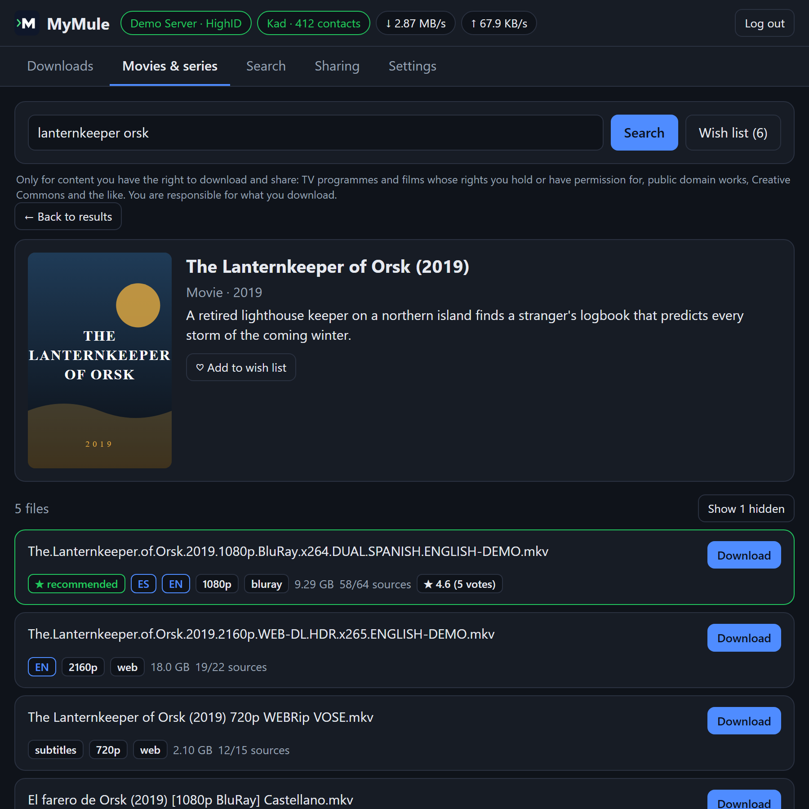
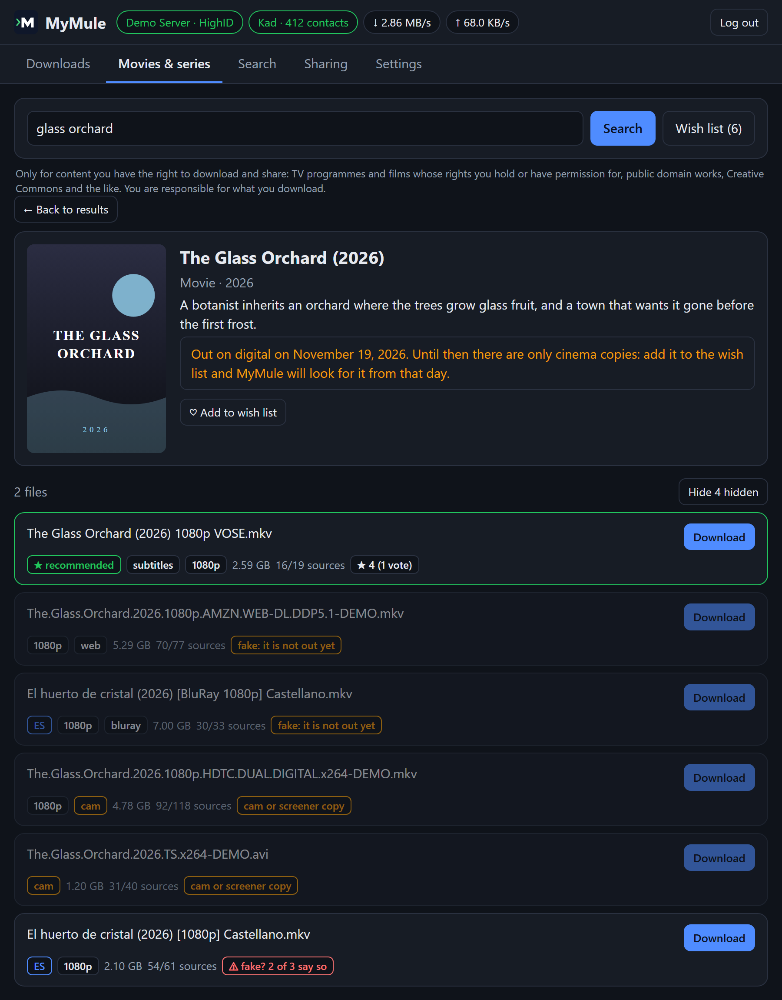
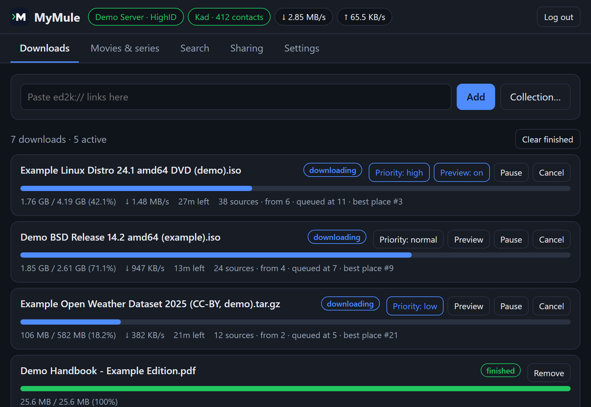
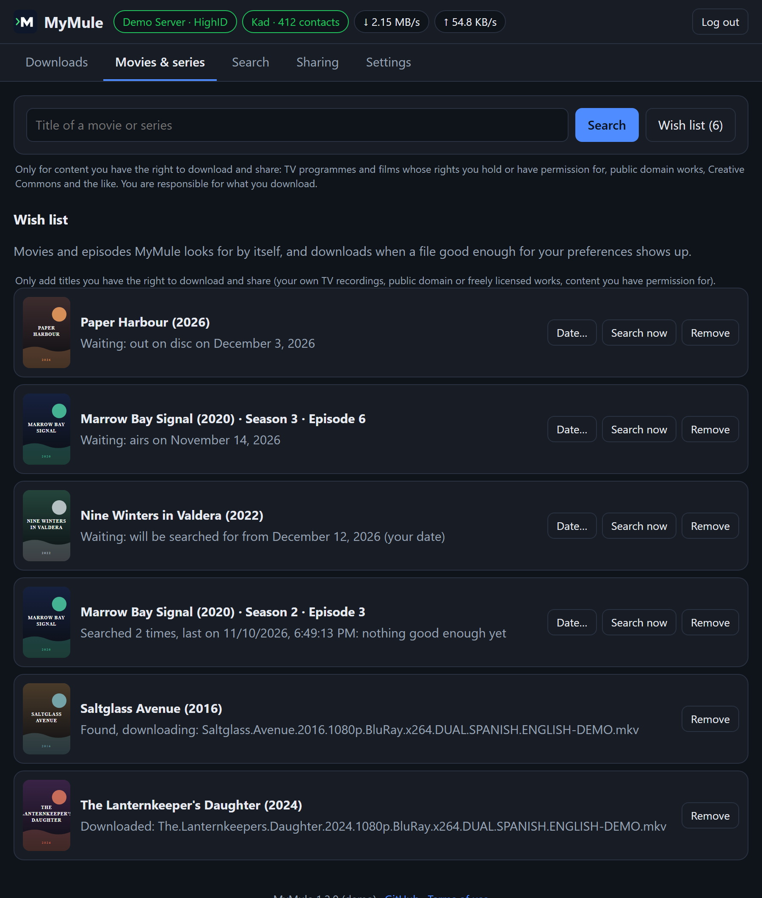

# Movies and series in MyMule

MyMule's web interface has a **Movies & series** tab: you look a movie or
a series up by its title, MyMule finds its files on eD2K and Kad, tells
you which one is best for you, and puts it in your library with a proper
name when it finishes. With the **wish list**, it also waits for a title
to come out and downloads it by itself.

This guide explains how all of that works and how to set it up. The
titles and files in the examples are made up.

> **Only for content you have the right to download and share.** These
> tools are meant for TV programmes, films and series whose rights you
> hold or have permission for, works in the public domain, works under a
> license that allows sharing (such as Creative Commons), and your own
> recordings. Downloading or sharing copyrighted material without
> permission may be illegal where you live. MyMule doesn't host, index or
> provide any content, and the movie database only describes titles: it
> doesn't make them free to download. You alone are responsible for what
> you download and share; see the
> [terms of use](../README.md#terms-of-use-and-disclaimer).

- [Before you start](#before-you-start)
- [Finding a movie or series](#finding-a-movie-or-series)
- [How the files are chosen](#how-the-files-are-chosen)
- [Spotting fakes](#spotting-fakes)
- [Downloading into your library](#downloading-into-your-library)
- [The wish list](#the-wish-list)
- [Notifications and your media server](#notifications-and-your-media-server)
- [For scripts: the API](#for-scripts-the-api)
- [Questions](#questions)

## Before you start

1. Turn the web interface on in `mymule.conf` and restart MyMule:

   ```ini
   web_ui = true
   ```

2. Open `http://127.0.0.1:4711/` (or `http://<computer-ip>:4711/` with
   `api_listen = 0.0.0.0:4711`; see the README) and log in with the
   `api_key` from `mymule.conf`.

3. In **Settings**, check **Choosing files for movies and series**: the
   audio languages you want, best first (for example `es, en`), whether
   original version with subtitles is fine, your preferred resolution, a
   maximum size and whether to hide cam copies.

4. Optional, but what makes it shine: turn on **Organize movies and
   series** and choose your movies and series folders (see
   [Downloading into your library](#downloading-into-your-library)).

5. Keep **Kad** on (`kad = true`, the default): it finds more files, and
   it is where the ratings that spot fakes come from.

Movie and series data and posters come from [TMDB](https://www.themoviedb.org),
with [Wikidata](https://www.wikidata.org) as a fallback. MyMule includes
its own TMDB key: nothing to set up.

## Finding a movie or series

Type a title in the **Movies & series** tab, in your language or the
original one, and pick the right one from the list (poster, year,
original title and synopsis tell remakes and namesakes apart).

- **A movie**: MyMule searches at once.
- **A series**: choose a season and an episode (with their titles), or
  the whole season, and press **Search**. For a whole season you get the
  best file of each episode, and a **Download N episodes** button that
  downloads them all; **All files** lists every file found instead.

MyMule then searches every known eD2K server and Kad, by every title the
work has: yours, the original one and alternative ones (other countries,
other spellings). That takes about 10 seconds.

Only the files of that work are kept: not remakes from another year,
episodes of other shows, or other movies with a similar name. For a
series, files of another season or episode are left out, and so are files
that don't say which episode they are when you asked for one.

## How the files are chosen



<sub>Made-up movie and files, from MyMule's demo.</sub>

Each file gets a score from what its name says, and the best one is
marked **★ recommended**. In order of weight:

1. **Language.** Your first language scores most, the second a bit less,
   and so on. Original version with subtitles counts if you allowed it.
   When a name doesn't say the language, a file named with the title in
   your language is guessed to be in it (shown as `ES (by title)`).
   Files in other languages go down.
2. **Resolution.** Your preferred one scores most, the nearest ones next.
3. **Source.** Blu-ray and remux, then web, TV, DVD. Cinema copies (cam,
   telesync, HDTC, screener) go far down.
4. **Availability.** Complete sources weigh a lot on eD2K: a file many
   people have finishes sooner.

The tags under each file say what was read from its name: languages,
subtitles, resolution, source, season and episode, size and sources.

Some files are **hidden**, with the reason shown when you press **Show
hidden**:

| Reason | Why |
|---|---|
| no sources | nobody has it right now |
| only found on Kad/torrent | a server bridged it from another network: it may never download |
| cam or screener copy | recorded in a cinema (when **Hide cam copies** is on) |
| too big | over your maximum size |
| fake: it is not out yet | see [Spotting fakes](#spotting-fakes) |

## Spotting fakes

Fakes (files whose name promises a movie they are not) are common for
popular titles. MyMule has three defences, besides checking every part of
every file against its hash as it downloads (which proves you got the
file you asked for, not that the file is what its name says):

**Cinema copies.** Names saying `CAM`, `TS`, `HDTS`, `TC`, `HDTC`,
`TELESYNC`, `SCREENER` and the like are recognized as recorded in a
cinema, even when the name also says `DIGITAL` or `1080p`.



<sub>A made-up movie still in cinemas: its web and Blu-ray copies are hidden as fakes, its cinema copies as cam, and one file most users call fake goes last.</sub>

**Copies that cannot exist yet.** MyMule knows when a title comes out at
home (see [The wish list](#the-wish-list)). Before that day, a movie's
web, Blu-ray, DVD or TV copy cannot exist, and no file of an episode can
exist before it airs: such files are hidden as **fake: it is not out
yet**. If you see a "WEB-DL" of a movie that is still only in cinemas, it
is a fake (or a cinema recording with a lying name). A date that is only
an estimate is not used for this.

**What other users say.** eMule and aMule users can rate a file they have
(*fake or corrupt*, *poor*, *fair*, *good*, *excellent*) and leave a
comment; those notes are kept in Kad. After showing the files, MyMule asks
Kad for the notes of the first six:

- **★ 4.3 (6 votes)**: the average rating. Hover over it to read the
  comments.
- **⚠ fake? 2 of 3 say so**: at least half of the ratings say fake. The
  file goes to the end of the list and is never recommended.

You can add yours: a finished download has a **Rate** button (*fake or
corrupt*, *poor*, *fair*, *good*, *excellent*, and a comment). It is
published in Kad as eMule does, and again every 12 hours (Kad keeps notes
for a day), so other users see it too.

Only the rating counts, not the words of the comment (a comment saying
"fake" with no rating changes nothing; you can read it and decide). Many
files have no notes at all; then there is simply nothing to show. Answers
are kept for an hour.

## Downloading into your library

Press **Download** on a file. With **Organize movies and series** on, the
web interface tells you right away where the file will go, and when it
finishes MyMule renames and moves it into your movies or series folder,
ready for Plex, Jellyfin, Emby or Kodi:

```
Movies/Example Movie (1999)/Example Movie (1999).mkv
Series/Example Show/Season 01/Example Show - S01E02.mkv
```

The names come from templates you choose in **Settings** (with a live
example), using the title in your language or the original one. The
README's [Movie and series library](../README.md#movie-and-series-library)
section lists every tag. Files keep being shared after they are moved,
without hashing them again, if you choose to share those folders.

Other ways to steer a download, on each download of the **Downloads**
tab:

- **Priority** (high, normal, low): when there are more sources than
  connections, higher-priority downloads get them first.
- **Preview**: the first and last parts are downloaded first, so a video
  can be played before it is complete.



<sub>Made-up downloads: one with high priority and preview on, one with low priority.</sub>

## The wish list

The wish list is for what you want but can't get yet: a movie still in
cinemas, an episode that airs next week, or something whose files are all
in the wrong language for now. MyMule looks for it by itself and downloads
it when a good file shows up.



<sub>A made-up wish list with an entry in each state.</sub>

**Adding to it.** Open a movie or series (for a series, choose the season
and episode, or the whole season) and press **♡ Add to wish list**. If
the title is not out at home yet, the page also says when it comes out.

**When it searches.** Not before the title comes out at home:

- a movie: its first **digital or disc** release anywhere in the world
  (copies travel fast); if no such date is known yet, about 45 days after
  its cinema release, as an estimate;
- an episode: the day it **airs**; a whole season: the day its last
  episode airs.

Those dates come from TMDB and are checked again every day, since they get
announced, brought forward or put off. You can also **choose the day
yourself** with **Date…** in the wish list (and go back to the automatic
date with **When it comes out**), or press **Search now** to search at
once anyway.

From that day, each entry is searched for every 6 hours, and the whole
list at most once every 10 minutes, so the servers are not flooded.

**What it downloads.** The best file for your preferences, exactly as the
★ recommended one in the tab, with sources, and never:

- a cinema copy (cam, telesync, HDTC, screener), even if you show them in
  your searches: nobody is there to look at it first;
- a file that cannot exist yet, or one most users call fake (it asks Kad
  about up to three candidates before choosing).

If nothing good enough is found, it waits for the next search. When it
finds one, the file downloads and is organised like any other, and the
entry shows **Found, downloading**, then **Downloaded** when it finishes.
If you cancel that download, the entry goes back to the list, is searched
for again in the next few minutes, and that file is never taken again.

**Following a series.** On a series' page, **★ Follow the series from
season N** (the season chosen in the list) gets every episode from that
season on: the ones already aired, and the ones to come as they air.
MyMule keeps the list of episodes from the movie database (checked again
every day, so new seasons and episodes join by themselves), searches for
a season at a time (one search, not one per episode), and downloads the
best file of each aired episode it still needs, with the same rules as
above. In the wish list, a followed series shows what is downloaded,
downloading and still missing, and the next episode to air. Remove it to
stop following.

The wish list is kept in `wanted.json` in the data folder, and holds up
to 200 entries.

## Notifications and your media server

In **Settings › Advanced settings › Notifications and media server**:

- **Send notifications to** (`notify_urls`): ntfy (`ntfy://topic` or
  `ntfy://your-server/topic`), Telegram (`tgram://BOT_TOKEN/CHAT_ID`),
  Discord (`discord://WEBHOOK_ID/WEBHOOK_TOKEN`) or any `https://` address,
  which gets a JSON POST. Several, separated by spaces.
- **Notify about** (`notify_on`): `completed` (a download finished, with
  its name in your library), `wanted` (the wish list found a file and
  started it), `error` (a file could not be moved or finished).
- **Media server** (`media_server`, `media_server_url`,
  `media_server_token`): Jellyfin, Emby or Plex, asked to scan its
  libraries when files arrive (at most once every 2 minutes), so a movie
  shows up as soon as it is in place. Use an API key made in
  Jellyfin/Emby (Dashboard › API Keys) or your Plex token.

The **Test** button sends a notification and asks for a scan. Tokens are
never shown again once saved. Changes take effect when MyMule restarts.

## For scripts: the API

Everything in the tab is also in the HTTP API ([docs/API.md](API.md)):
`/api/v1/media/search`, `/api/v1/media/{id}/releases` (with `available`
when it is not out yet), `/api/v1/media/download`, the wish list under
`/api/v1/wanted`, and the ratings of a file at
`/api/v1/files/{hash}/notes`.

## Questions

**The recommended file is in the wrong language.** Check the audio
languages in **Settings**: the first one weighs most. A file whose name
says no language is only guessed from its title.

**It says a movie comes out on a date, but it is already on my streaming
service.** The date is the first digital or disc release TMDB knows of,
anywhere. If yours came earlier, press **Search now**, or choose the date
yourself.

**The wish list hasn't found anything for days.** Maybe there is no file
in your languages yet. Look the title up in the tab to see what there is,
and what is hidden and why.

**Why didn't it take the file with the most sources?** It may be in
another language, a cinema copy, a fake, or bigger than your maximum size;
press **Show hidden** to see the reasons.
