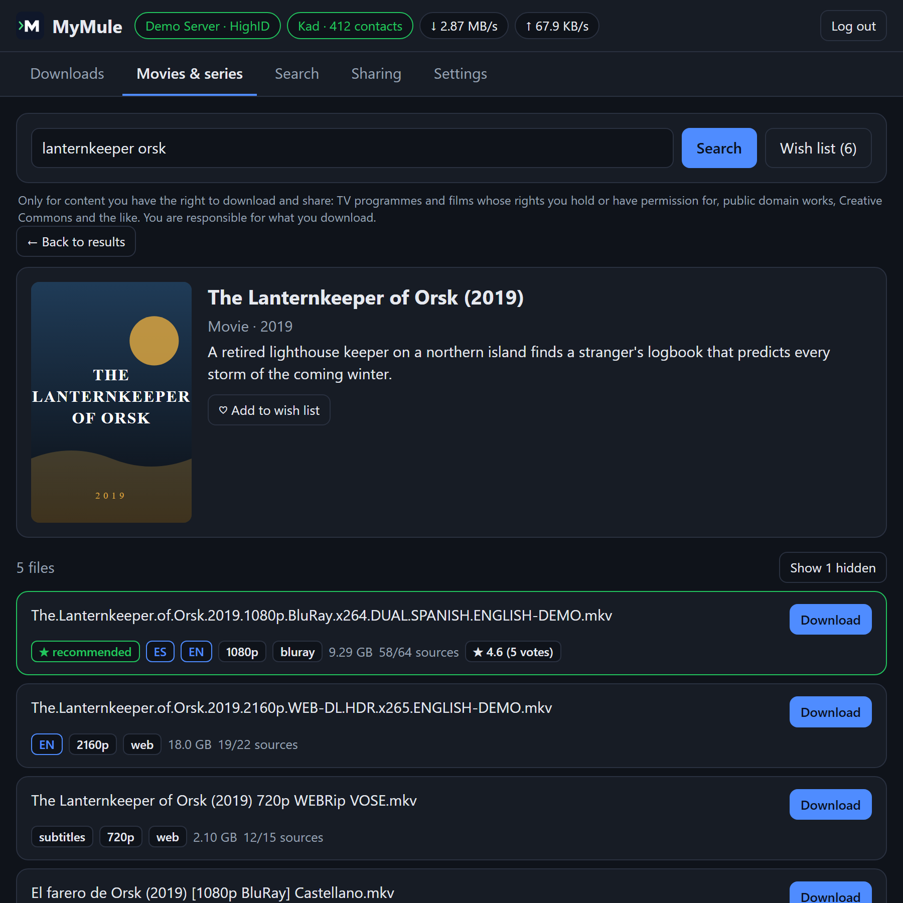
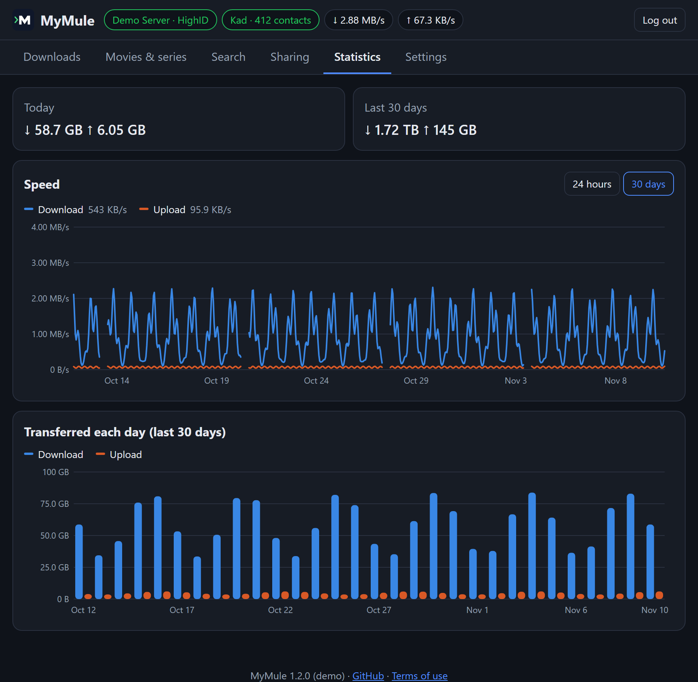

# The web interface

An optional web interface, built into the program (no extra files). It is
**off by default**; turn it on in `mymule.conf` and restart the daemon:

```ini
web_ui = true
```

Then open `http://127.0.0.1:4711/` (the `api_listen` address) and log in
with the `api_key` from `mymule.conf`.



<sub>The Movies & series tab with demo data: the titles and files are made up.</sub>

## The tabs

It has six tabs:

- **Downloads**: progress, speed, sources and queue position; pause,
  resume, cancel, priority, preview (first and last parts first),
  category, clear finished, and add `ed2k://` links or a collection.
- **Movies & series**: search a movie or series by title, in your
  browser's language, and pick it from a list with posters (title, year,
  original title, synopsis). MyMule then searches eD2K by all its titles
  (yours, the original and alternative ones), keeps only the files of
  that work (not remakes, episodes of other shows or other movies with
  similar names) and shows them with their language, resolution, source,
  size and sources, the recommended one first. Files with no sources,
  only found on Kad/torrent, or cam copies are hidden but can be shown.
  For series, pick a season and an episode from the lists (with episode
  titles), or the whole season (the best file of each episode, ready to
  download all at once). Files people rate as fakes, and copies
  that cannot exist yet, are marked; and the **wish list** waits for a
  title to come out and downloads it by itself. The full guide:
  [MEDIA.md](MEDIA.md).
  Only for content you have the right to download and share: TV
  programmes and films whose rights you hold or have permission for,
  public domain works, Creative Commons and the like (see the
  [terms of use](../README.md#terms-of-use-and-disclaimer)).
- **Search**: search every known server, with type, size and extension
  filters; sort and filter the results and download one or several
  (into a category, if you choose one).
- **Sharing**: shared files, upload speed and who is downloading from you.
- **Statistics**: download and upload speed over the last 24 hours or 30
  days, what was transferred each day, and totals for today, the last 30
  days and all time.

  
- **Settings**: how files for movies and series are chosen (audio
  languages in order of preference, original version with subtitles,
  preferred resolution, maximum size, hide cam copies), the movie and
  series library (see [Library folders and file names](MEDIA.md#library-folders-and-file-names)), the **categories** (a name and a folder
  each, optionally shared), and **Advanced settings**: everything in
  `mymule.conf` (ports, Kad, UPnP, folders, sharing, speed limits, the IP
  filter list...), written into the file and applied when MyMule
  restarts. Who can reach MyMule (`api_listen`, `api_key`, `api_hosts`,
  `network_hosts`, `web_ui`) is shown but only changed in the file. It
  also says which ports UPnP / NAT-PMP opened on the router, as does a
  chip at the top and `mymule status`. The **Notifications and media
  server** group sets where notifications go and which Jellyfin, Emby or
  Plex to tell, with a **Test** button; their tokens are never shown
  again once saved.

## The server list

Click the server name at the top to see the server list, sorted by users
or files: connect to another server, choose one to always use (the others
are tried only if it doesn't answer) or download a fresh list. Global
searches and sources use all servers anyway.

## Phones and the app

It works on phones, follows the system's light or dark theme and is shown
in English or Spanish depending on the browser's language.

It can be **installed as an app** (with its own icon and window, and it
opens even without a network, showing the last page): browsers allow that
over HTTPS (for example behind a reverse proxy) or on the computer MyMule
runs on. Over plain `http://` on your network, phones still offer **Add to
Home Screen**, which on an iPhone opens it full screen like an app.

## Using it from other devices

To use it from another device (a phone, another computer), set
`api_listen = 0.0.0.0:4711` and open `http://<computer-ip>:4711/`. Only do
this on a network you trust, and never forward port 4711 in your router.
If you open it by a name instead of an address (a NAS name, a domain
behind a reverse proxy), add that name to `api_hosts`.

## Sessions and security

The session lasts 30 days. **Log out** ends it for good, also for any copy
of the session cookie; changing `api_key` logs everybody out. After 10
wrong keys from one address, that address is blocked for 15 minutes; a
long random key like the generated one keeps working even then, so
nobody can lock you out, and wrong keys that other web sites make your
browser send don't count.

When `web_ui = false` the pages don't exist and nothing extra runs; the
interface only uses resources while a browser has it open.
